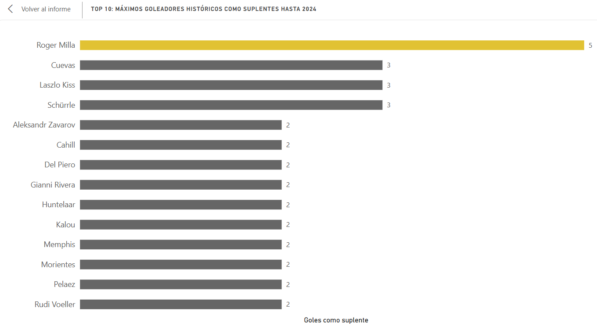
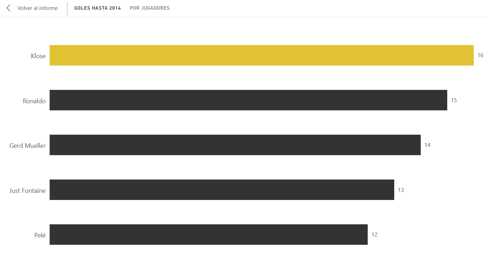
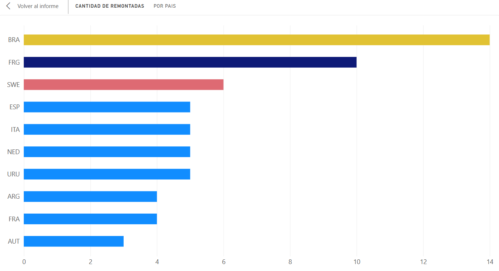
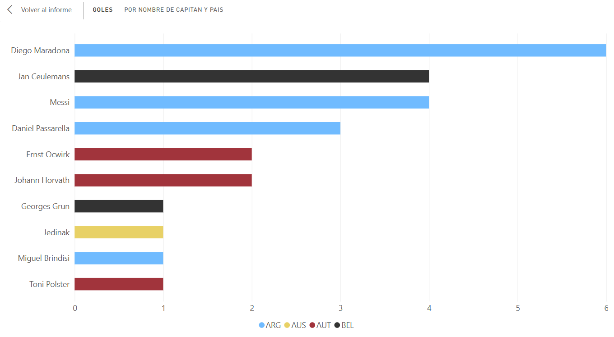
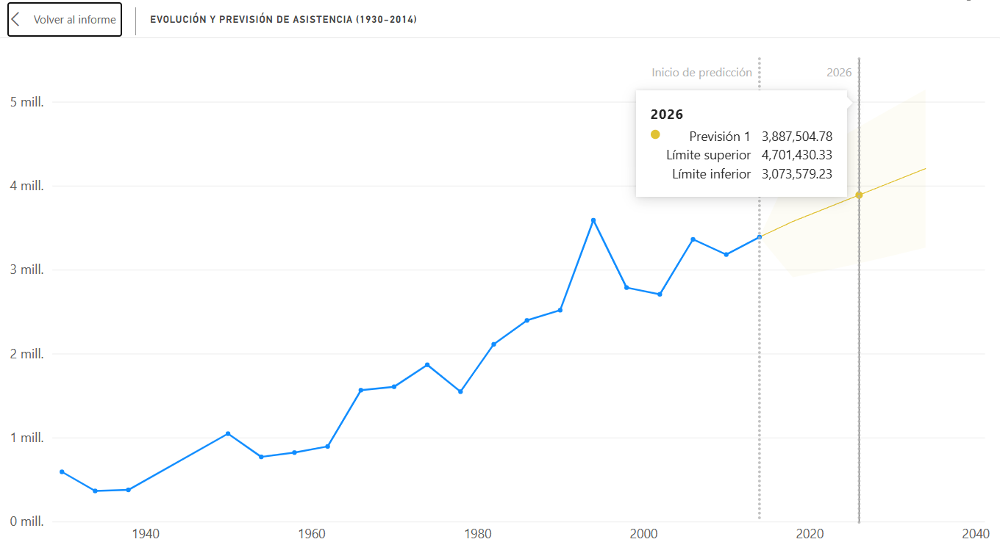

# Análisis Histórico y Proyecciones de la Copa Mundial de la FIFA (1930-2014)

## Descripción del Proyecto

Proyecto de Inteligencia de Negocios e Ingeniería de Datos (ETL) enfocado en analizar la historia de las Copas del Mundo. El objetivo es responder preguntas clave de negocio sobre el impacto de jugadores desde la banca, el liderazgo de capitanes, la resiliencia histórica de las selecciones y proyectar el crecimiento de la asistencia a los estadios.

## Stack Tecnológico

- **Python (Pandas):** Extracción, limpieza y transformación compleja de datos (Data Wrangling).
- **SQL Server (SSMS):** Carga de datos, lógica relacional (JOINs) y creación de vistas estructuradas.
- **Power BI:** Modelado de datos, diseño de visualizaciones (Data Storytelling) y análisis predictivo (Forecasting).

## Origen de los Datos

Los datos originales fueron extraídos de Kaggle, recopilados inicialmente por el FIFA World Cup Archive website. El conjunto consta de información histórica de torneos, estadísticas de partidos y registros detallados de jugadores. [Dataset Fifa World Cup](https://www.kaggle.com/datasets/abecklas/fifa-world-cup?select=WorldCupPlayers.csv)

## Flujo de Trabajo (Pipeline ETL)

1. **Extracción (Extract):** Lectura de los archivos CSV crudos.
2. **Transformación (Transform - Python):** Solución de anidamiento de datos (múltiples eventos en una sola celda). Se aplicó la función `explode()` junto con Expresiones Regulares para separar tipos de eventos y minutos en filas independientes sin corromper la integridad relacional. Se estandarizaron nulos y eliminaron duplicados.
3. **Carga y Modelado (Load - SQL Server):** Importación a base de datos relacional y desarrollo de consultas SQL para aislar la lógica de negocio, empaquetadas en vistas (VIEWS) optimizadas.
4. **Visualización (Power BI):** Conexión directa a SQL Server para el desarrollo de un panel ejecutivo interactivo y pronósticos estadísticos.

## Preguntas de Negocio y Hallazgos Clave

### 1. ¿Quiénes son los máximos goleadores históricos como suplentes?

**Hallazgo:** El camerunés Roger Milla domina históricamente este rubro con 5 goles entrando de cambio, demostrando el mayor impacto inmediato ofensivo.


### 2. Top 5 Máximos Anotadores en la Historia (1930-2014)

**Hallazgo:** Miroslav Klose (Alemania) se posiciona como líder absoluto con 16 anotaciones, seguido de Ronaldo (15) y Gerd Müller (14).


### 3. ¿Qué selecciones tienen la mayor resiliencia (Remontadas)?

**Hallazgo:** Brasil posee la mayor capacidad de reacción histórica (14 remontadas), seguida por la República Federal de Alemania (10) y Suecia (6).


### 4. Impacto del Liderazgo: Goles como Capitán

**Hallazgo:** Diego Maradona lidera el registro histórico con 6 anotaciones portando el gafete de capitán.


### 5. Proyección y Análisis de Anomalías en la Asistencia (Forecasting)

**Análisis de Anomalía (El factor 2026):** El modelo predictivo de series de tiempo proyectó un límite superior de 4.7 millones de asistentes para el Mundial de 2026, asumiendo la continuidad matemática del formato de 32 equipos. La expectativa real de 6.8 millones de asistentes expone una anomalía estructural en los datos: la expansión comercial del torneo a 48 selecciones y 104 partidos. Esto demuestra que el modelado predictivo estricto siempre debe cruzarse con el contexto operativo del negocio.


## Estructura del Repositorio

```text
├── 01_Datos/
│   ├── Crudos/                   # CSVs originales extraídos
│   └── Limpios/                  # CSVs procesados listos para ingesta
├── 02_Scripts/
│   ├── limpieza_datos.ipynb      # Código ETL en Python
│   └── vistas_analisis.sql       # Consultas y lógica de negocio
├── 03_Dashboard/
│   ├── Dashboard_Mundiales.pbix  # Archivo fuente de Power BI
│   └── Dashboard_Preview.pdf     # Vista previa estática
└── README.md
```
